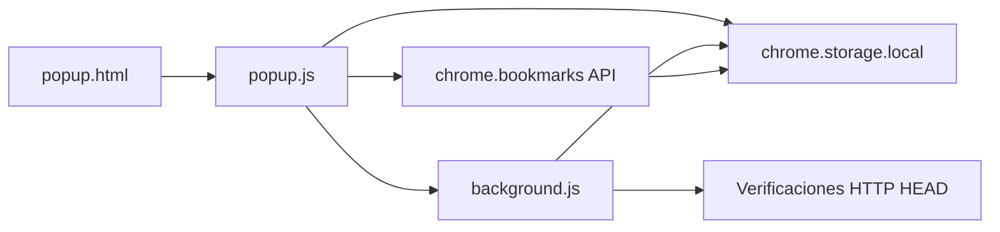

# Requisitos

### Descripción General y Objetivos
Crear una extensión de Chrome que proporcione una gestión superior de marcadores comparada con la herramienta nativa del navegador, con tres capacidades principales: búsqueda inteligente con resaltado, agrupación automática por dominio, y detección de enlaces muertos con eliminación masiva.

### Historias de Usuario
- Como usuario, quiero buscar mis marcadores por título o URL y ver los términos coincidentes resaltados en los resultados.
- Como usuario, quiero que mis marcadores se agrupen automáticamente por dominio (ej. google.com, github.com) para navegarlos por sitio.
- Como usuario, quiero detectar marcadores con enlaces rotos (404, tiempos de espera) y eliminarlos en lote.
- Como usuario, quiero operaciones CRUD básicas (renombrar, editar URL, eliminar) en marcadores individuales.

### Requisitos Funcionales
1. **Búsqueda con resaltado**: Filtrado en tiempo real de marcadores por título y URL, con términos coincidentes resaltados en amarillo.
2. **Agrupar por host**: Auto-agrupar todos los marcadores por nombre de dominio, mostrados como carpetas colapsables.
3. **Detector de enlaces muertos**: Solicitudes HTTP HEAD para detectar enlaces rotos, con botón "eliminar todos los muertos".
4. **CRUD básico**: Renombrar, editar URL y eliminar marcadores individuales desde la interfaz.
5. **UI Popup**: Un popup limpio con pestañas para Búsqueda, Grupos y Enlaces Muertos.

### Requisitos No Funcionales
- **Rendimiento**: La búsqueda debe ser instantánea (filtrado del lado del cliente).
- **Privacidad**: Todos los datos permanecen locales; sin llamadas a APIs externas excepto verificaciones de salud.
- **Compatible con Chrome Manifest V3**.

# Diseño Técnico

### Implementación Actual
El proyecto está vacío — es una extensión de Chrome desde cero.

### Decisiones Clave
- **Manifest V3**: Usar la última API de extensiones de Chrome con service worker como script de fondo.
- **UI solo Popup**: Sin página de opciones inicialmente; todo vive en el popup con navegación por pestañas.
- **API chrome.bookmarks**: Para leer, crear, actualizar y eliminar marcadores.
- **Verificaciones de salud vía proxy**: Debido a CORS, las verificaciones de enlaces muertos usarán un patrón de solicitud HEAD con fallback de tiempo de espera.
- **Almacenamiento local**: Cachear el árbol de marcadores en `chrome.storage.local` para evitar llamadas repetidas a la API.

### Cambios Propuestos
Crear una nueva extensión de Chrome con la siguiente estructura:

```
chrome-bookmark-manager/
├── manifest.json            # Manifiesto de la extensión (V3)
├── popup.html               # UI del popup con pestañas
├── popup.css                # Estilos
├── popup.js                 # Lógica del popup (búsqueda, grupos, enlaces muertos)
├── background.js            # Service worker (caché de marcadores, verificaciones de salud)
├── icons/
│   ├── icon16.png
│   ├── icon48.png
│   └── icon128.png
└── README.md
```

### Componentes
1. **`manifest.json`**: Declara permisos (`bookmarks`, `storage`), popup y service worker de fondo.
2. **`popup.html`**: Interfaz de tres pestañas:
   - **Pestaña Búsqueda**: Campo de texto + lista de resultados con coincidencias resaltadas.
   - **Pestaña Grupos**: Carpetas colapsables agrupadas por dominio.
   - **Pestaña Enlaces Muertos**: Indicador de progreso + lista de marcadores muertos con eliminación masiva.
3. **`popup.js`**: Maneja la lógica de la UI, filtrado de búsqueda, resaltado y agrupación por dominio.
4. **`background.js`**: Caché del árbol de marcadores, realiza verificaciones HTTP de salud y expone resultados al popup.
5. **Resaltado**: Reemplazo con regex para envolver términos coincidentes en etiquetas `<mark>` en los resultados.

### Diagrama de Arquitectura



### Riesgos
- **CORS para verificaciones de salud**: Las solicitudes HEAD a URLs externas pueden ser bloqueadas; se usará un fallback basado en tiempo de espera y se marcará como "desconocido" si no es accesible.
- **Conjuntos grandes de marcadores**: Para usuarios con más de 10k marcadores, la carga inicial puede ser lenta; se implementará carga diferida por grupo.

# Pruebas

### Enfoque de Validación
Pruebas manuales en Chrome con la extensión cargada en modo desarrollador.

### Escenarios Clave
1. **Búsqueda**: Ingresar un término que coincida con títulos/URLs de marcadores, verificar que los resultados aparecen con términos resaltados.
2. **Grupos**: Abrir la pestaña Grupos, verificar que los marcadores están organizados por dominio con carpetas colapsables.
3. **Enlaces Muertos**: Disparar una verificación de salud, verificar que los enlaces muertos se detectan y se pueden eliminar en lote.
4. **CRUD**: Renombrar, editar URL y eliminar un marcador, verificar que los cambios persisten.

### Casos Extremos
- Árbol de marcadores vacío
- Marcadores sin URL (solo carpetas)
- Listas de marcadores muy largas (rendimiento)
- Tiempos de espera de red durante verificaciones de salud
- Caracteres especiales en términos de búsqueda (escape de regex)

# Delivery Steps

### ✓ Step 1: Crear esqueleto de la extensión y manifiesto
Configurar la estructura del proyecto con manifest.json, popup.html, popup.css, popup.js y background.js.
- Crear `manifest.json` con Manifest V3, permisos para `bookmarks` y `storage`, y configuración del popup.
- Crear `popup.html` con un diseño de tres pestañas (Búsqueda, Grupos, Enlaces Muertos).
- Crear `popup.css` con estilos básicos para pestañas, campo de búsqueda y lista de resultados.
- Crear `background.js` como esqueleto de service worker.
- Agregar íconos placeholder (16x16, 48x48, 128x128).

### ✓ Step 2: Implementar búsqueda con resaltado
Construir la funcionalidad de búsqueda que filtra marcadores por título/URL y resalta los términos coincidentes.
- En `background.js`, cachear el árbol de marcadores desde `chrome.bookmarks` en `chrome.storage.local`.
- En `popup.js`, implementar filtrado de búsqueda en tiempo real con resaltado de términos basado en regex usando etiquetas `<mark>`.
- Mostrar resultados en una lista desplazable con título del marcador, URL y resaltado.
- Agregar comportamiento de clic para abrir marcadores.
- Manejar caracteres especiales en términos de búsqueda escapando metacaracteres de regex.

### ✓ Step 3: Implementar agrupación por host
Auto-agrupar marcadores por nombre de dominio en la pestaña Grupos.
- Extraer el dominio de la URL de cada marcador usando `new URL(url).hostname`.
- Agrupar marcadores por dominio y mostrarlos como carpetas colapsables.
- Ordenar grupos alfabéticamente.
- Soportar expandir/colapsar grupos.
- Manejar marcadores sin URL (carpetas) colocándolos en un grupo "Carpetas".
- Agregar comportamiento de clic para abrir marcadores agrupados.

### ✓ Step 4: Implementar detector de enlaces muertos
Agregar funcionalidad de verificación de salud para detectar y eliminar en lote marcadores rotos.
- En `background.js`, implementar solicitudes HTTP HEAD con tiempo de espera de 5 segundos para cada URL de marcador.
- Clasificar resultados como: OK (2xx), Muerto (4xx/5xx), Tiempo de espera, o Desconocido.
- En `popup.js`, mostrar una barra de progreso durante las verificaciones y una lista de marcadores muertos.
- Agregar un botón "Eliminar Todos los Muertos" que elimine marcadores muertos vía `chrome.bookmarks.remove`.
- Manejar errores de CORS de manera graceful marcándolos como "Desconocido" en lugar de fallar.

### ✓ Step 5: Agregar operaciones CRUD básicas
Habilitar renombrar, editar URL y eliminar para marcadores individuales.
- Agregar botones de acción en línea (editar, eliminar) junto a cada marcador en las tres pestañas.
- Implementar un diálogo modal para editar título y URL del marcador.
- Conectar las APIs `chrome.bookmarks.update` y `chrome.bookmarks.remove`.
- Actualizar el árbol de marcadores en caché después de los cambios.
- Agregar diálogo de confirmación antes de la eliminación.

### ✓ Step 6: Mejoras adicionales
Agregar funcionalidades solicitadas por el usuario.
- Agregar botón individual para verificar si un enlace está muerto en resultados de búsqueda y grupos.
- Agregar botón "Colapsar todo" en la pestaña Grupos y mostrar grupos colapsados por defecto.
- Hacer que la verificación de enlaces continúe en el background aunque se cierre el popup, con notificación al completar.
- Regenerar los íconos con diseño simple (sin emoji) para que se muestren correctamente en la barra de extensiones.

### ✓ Step 7: Internacionalización y mejoras de UI
Preparar la aplicación para soportar varios idiomas y mejorar detalles de UI.
- Crear sistema de traducciones i18n.js con soporte para castellano e inglés, fácil de extender.
- Reemplazar todos los textos hardcodeados en popup.js con llamadas a t().
- Añadir selector de idioma en el popup para cambiar entre ES/EN.
- Mostrar la versión de la aplicación a la derecha del título.
- Hacer más pequeño el botón "Eliminar Todos" de búsqueda (solo emoji 🗑️) alineado a la derecha.
- Mostrar advertencia con el número de elementos al eliminar resultados de búsqueda.
- Incrementar versión a 1.1.0 en manifest.json.
- Actualizar notificación de background.js para usar el idioma del usuario.